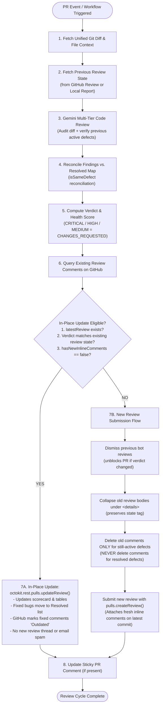

# 🔄 Universal AI PR Review Bot: Lifecycle & Review Flow Guide

This document details the complete end-to-end operational flow of the **Universal AI PR Review Bot**, explaining when reports are updated in-place, when new reviews are submitted, when previous reviews are dismissed, and how comments are preserved or cleaned up across commits.

---

## 📑 Table of Contents
1. [Core Principles & Architecture](#-core-principles--architecture)
2. [Review Lifecycle Decision Flow](#-review-lifecycle-decision-flow)
3. [In-Place Update vs. New Review Submission](#-in-place-update-vs-new-review-submission)
4. [Review Dismissal & Comment Lifecycle](#-review-dismissal--comment-lifecycle)
5. [Defect Matching Engine (`isSameDefect`)](#-defect-matching-engine-issamedefect)
6. [Resolved Defects Tracking & Reconciliation](#-resolved-defects-tracking--reconciliation)
7. [Manual Test Cases (Verification Suite)](#-manual-test-cases-verification-suite)

---

## 🏛️ Core Principles & Architecture

The review bot is designed to keep PR discussion clean, avoid email and thread spam, and maintain an audit trail of resolved issues across commits:

* **Zero Duplicate Comment Stacking:** Still-active defects being re-posted on the latest commit never leave duplicate comment boxes stacked on top of each other in the *Files Changed* tab.
* **Audit Trail Preservation:** Comments for defects that were **fixed** are **never deleted**. GitHub preserves them in history with an `Outdated` badge.
* **State Continuity:** Each review embeds an invisible machine-readable payload (`<!-- ai-review-state: {...} -->`) preserving all active findings and cumulative resolved defects across all review rounds.
* **Smart In-Place Updates:** If the review verdict has not changed and no new comments need to be attached, the bot updates the existing review in-place rather than opening new review threads.

---

## 🗺️ Review Lifecycle Decision Flow



---

## ⚖️ In-Place Update vs. New Review Submission

The bot uses the following logic in [src/github-service.ts](file:///d:/My_Tasks/AI_Agent_Skills_Learning/PR_Review_Bot/src/github-service.ts) to determine whether to update an existing review or create a new one:

### Case 1: In-Place Review Update (`octokit.rest.pulls.updateReview`)
Triggered when **all three** of the following conditions are met:
1. **Existing Bot Review Exists:** An active, non-dismissed review by the bot is present on the PR.
2. **Verdict State Matches:**
   * Both old review and current review are `CHANGES_REQUESTED`.
   * **OR** both old review and current review are `COMMENT` / `APPROVE`.
3. **No Brand-New Inline Comments Needed (`hasNewInlineComments === false`):**
   * All active findings already have an active, non-outdated comment on that exact file and line on GitHub.
   * None of the findings are re-introduced defects that were previously marked resolved.

**What happens on GitHub:**
* The existing review body updates in-place.
* The Health Score, Letter Grade, and Issue Counts update in-place.
* Any fixed defects move from `### 🔎 Review Findings` to `### ✅ Resolved Defects`.
* GitHub automatically marks the fixed bug's comment as **`Outdated`** and collapses it.
* **No duplicate review thread, no merge blocker confusion, and no email spam.**

---

### Case 2: New Review Submission (`octokit.rest.pulls.createReview`)
Triggered when **any one** of the following occurs:
1. **First-Time Review:** No prior bot review exists on the PR.
2. **Verdict State Changed:**
   * e.g., All `CRITICAL`, `HIGH`, and `MEDIUM` defects were fixed, so the verdict transitions from `CHANGES_REQUESTED` to `COMMENT`.
   * *Why?* The GitHub REST API does not allow changing a review's native state (clearing `CHANGES_REQUESTED`) through `updateReview`; only a new review submission can clear it.
3. **Brand-New Inline Comments Needed (`hasNewInlineComments === true`):**
   * The developer introduced a brand-new defect on a line that was never commented on.
   * **OR** the developer re-introduced a defect that was previously resolved (requiring a fresh, active comment on the new commit).

---

## 🗑️ Review Dismissal & Comment Lifecycle

When a new review is submitted (Case 2), previous reviews and comments undergo clean lifecycle management:

```
┌──────────────────────────────────────┬──────────────────────────────────────────────────────────────┐
│ Item                                 │ Action Taken & Behavior on GitHub                            │
├──────────────────────────────────────┼──────────────────────────────────────────────────────────────┤
│ Previous Bot Review                  │ DISMISSED via octokit.rest.pulls.dismissReview.             │
│                                      │ Unblocks merge requirements if changes were addressed.       │
├──────────────────────────────────────┼──────────────────────────────────────────────────────────────┤
│ Previous Review Body                 │ Collapsed under:                                             │
│                                      │ <details><summary>📦 Outdated AI Review Report</summary>...  │
│                                      │ Embedded <!-- ai-review-state: ... --> is preserved.         │
├──────────────────────────────────────┼──────────────────────────────────────────────────────────────┤
│ Still-Active Defect's Old Comment    │ DELETED via octokit.rest.pulls.deleteReviewComment.          │
│                                      │ Prevents duplicate comment boxes from stacking on that line. │
│                                      │ Replaced by the fresh comment on the new commit.             │
├──────────────────────────────────────┼──────────────────────────────────────────────────────────────┤
│ Resolved Defect's Old Comment        │ PRESERVED FOREVER (NEVER deleted).                           │
│                                      │ GitHub automatically marks it [Outdated] and collapses it.  │
│                                      │ Serves as permanent audit history of what was fixed.        │
└──────────────────────────────────────┴──────────────────────────────────────────────────────────────┘
```

---

## 🔍 Defect Matching Engine (`isSameDefect`)

Accurately matching defects across commits is critical. The matching engine in [src/reviewer.ts](file:///d:/My_Tasks/AI_Agent_Skills_Learning/PR_Review_Bot/src/reviewer.ts) operates under these strict rules:

1. **Path Normalization:**
   * Strips git prefixes (`a/`, `b/`), relative prefixes (`./`), converts `\` to `/`, and performs case-insensitive comparison.
2. **Exact Start Line Match:**
   * Same start line in the same file is always a match.
3. **Overlapping Replacement Ranges:**
   * If line ranges overlap (`startA <= endB && startB <= endA`), they match unless their titles have completely disjoint domain keywords.
4. **Proximity with Title Keywords ($\le 5$ lines):**
   * If lines are within 5 lines of each other, they match if they share at least 1 domain keyword or exact title.
5. **Line Shifts ($\le 35$ lines):**
   * If code was inserted or deleted above, line numbers shift. Defects match if they share $\ge 2$ domain keywords or exact title.
6. **Multi-Defect Isolation in Same Method:**
   * Two separate defects in the same method (e.g. Bug 1 on lines 250-255 vs Bug 2 on lines 257-266) with disjoint keywords (`['priority', 'sorting']` vs `['due', 'date', 'nan']`) **never** falsely match each other, even if they share the same category (`Correctness`).

---

## 📋 Resolved Defects Tracking & Reconciliation

1. **State Persistence Across Commits:**
   * When a report is generated, the full list of active findings and resolved findings is saved into:
     ```html
     <!-- ai-review-state: {"findings": [...], "resolved": [...]} -->
     ```
2. **Reconciliation Steps:**
   * **Step 1:** Carry forward all previously resolved defects unless re-introduced in current code (`!validatedFindings.some(vf => isSameDefect(prevRes, vf))`).
   * **Step 2:** Add defects confirmed resolved by Gemini (`aiResponse.resolvedDefectIds`).
   * **Step 3 (Safety Net):** Any previous defect no longer detected in current code is automatically marked resolved.
   * **Final Filter:** No defect present in `validatedFindings` can ever appear in `resolvedFindings`.

---

## 🧪 Manual Test Cases (Verification Suite)

Use these manual test cases to verify the bot on any PR branch.

### Test Case 1: Initial PR Review with 2 Defects
* **Setup:** Push code containing 2 intentional bugs in `frontend/src/app/app.ts`:
  * **Bug 1 (lines 250-255):** Alphabetical priority sorting flaw (`localeCompare('HIGH', 'LOW')`).
  * **Bug 2 (lines 257-266):** Missing due date NaN comparator (`new Date(dueDate).getTime()`).
* **Expected Result:**
  * Verdict: `🔴 CHANGES REQUESTED`.
  * Top-level summary shows `Total Issues: 2`, `Critical: 0`, `High: 0`, `Medium: 2`.
  * `### 🔎 Review Findings` contains Bug 1 and Bug 2.
  * `### ✅ Resolved Defects` is not present (0 resolved).
  * 2 inline comments attached with ```suggestion``` blocks.

---

### Test Case 2: Fix 1 Defect & Re-review (In-Place Update)
* **Setup:** Commit a fix for **Bug 2** (add `!isNaN(time)` checks). Leave Bug 1 untouched.
* **Expected Result:**
  * Verdict remains: `🔴 CHANGES REQUESTED` (due to remaining Medium Bug 1).
  * **Existing review is updated IN-PLACE:** No new review thread or email notification.
  * Scorecard updates: `Total Issues: 1`.
  * `### 🔎 Review Findings (1)` contains only Bug 1.
  * `### ✅ Resolved Defects (1)` contains Bug 2 with `~~strikethrough~~` and `✅ Resolved`.
  * In *Files Changed*:
    * Bug 1 inline comment remains active.
    * Bug 2 inline comment is marked **`Outdated`** and collapsed by GitHub (not deleted!).

---

### Test Case 3: Re-review Without Any Changes (Idempotency)
* **Setup:** Re-trigger the review workflow without making any new commits.
* **Expected Result:**
  * Existing review is updated **in-place**.
  * No new review thread.
  * No duplicate inline comments.
  * Scorecard and tables remain identical.

---

### Test Case 4: Fix Remaining Defect (PR Unblocked)
* **Setup:** Commit a fix for **Bug 1** (use rank map `{ HIGH: 3, MEDIUM: 2, LOW: 1 }`).
* **Expected Result:**
  * Verdict transitions: `🟢 ALL LOOKS GOOD` (or `APPROVE_WITH_COMMENTS`).
  * **Previous review is DISMISSED** (clearing the `CHANGES_REQUESTED` merge blocker).
  * Previous review body is collapsed under `📦 Outdated AI Review Report (Superseded)`.
  * New review is submitted with `COMMENT` verdict.
  * `### 🌟 Review Findings`: All looks good! Clean PR diff ready for merge.
  * `### ✅ Resolved Defects (2)`: Both Bug 1 and Bug 2 listed as resolved.
  * In *Files Changed*: Both Bug 1 and Bug 2 comments are preserved as **`Outdated`** for audit proof.

---

### Test Case 5: Re-introduce a Resolved Defect
* **Setup:** Re-introduce **Bug 1** into the code and push a commit.
* **Expected Result:**
  * Bug 1 is detected as active in the diff.
  * **Bug 1 is stripped from the Resolved list**: `Resolved Defects` now only contains Bug 2.
  * `hasNewInlineComments` evaluates to `true` (since Bug 1 was re-introduced).
  * Previous review is dismissed.
  * **A new active inline comment for Bug 1 is posted on the latest commit.**
  * Old comment for Bug 1 from earlier commits is cleaned up to prevent duplicate comment stacking.

---

### Test Case 6: Proximity Defect Isolation (Same Method, 2 Lines Apart)
* **Setup:** Introduce 2 distinct `Correctness` defects in the same method separated by only 2 lines (e.g. lines 250-255 vs lines 257-266).
* **Expected Result:**
  * `isSameDefect(Bug 1, Bug 2)` returns `false`.
  * Fixing one does not falsely mark the other resolved.
  * Re-introducing one does not affect the resolution status of the other.
  * Deleting stale comments for Bug 1 never deletes comments belonging to Bug 2.
